<div align="center">


# Glassline

**Smart route collection for waste-glass recycling**
A Flutter mobile app and a .NET backend that plan the shortest collection route, verify every stop with a barcode scan, work offline, and report on every trip.

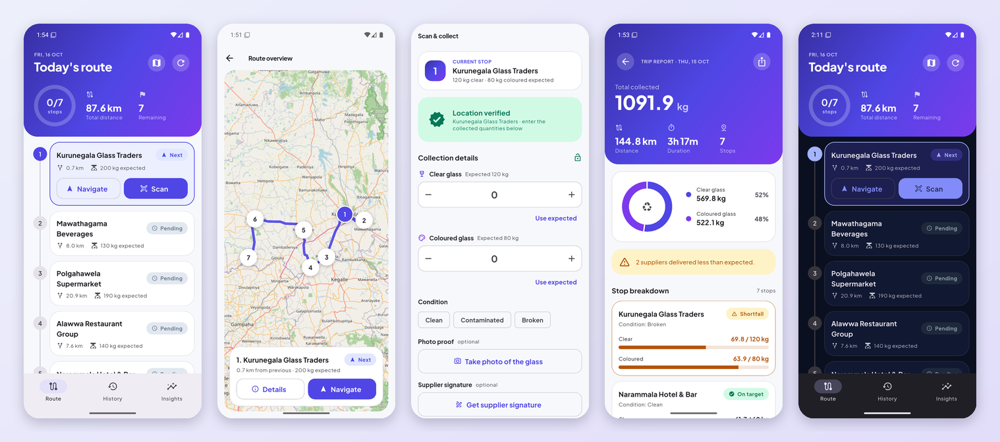

</div>

---

## Contents

1. [Overview](#1-overview)
2. [Architecture](#2-architecture)
3. [Design](#3-design)
4. [Feature walkthrough](#4-feature-walkthrough)
5. [Requirements traceability](#5-requirements-traceability)
6. [Testing](#6-testing)
7. [Running it locally](#7-running-it-locally)
8. [Known limitations and next steps](#8-known-limitations-and-next-steps)

---

## 1. Overview

A collector drives to several supplier sites each day to pick up waste glass. Glassline gives them:

- a **route** (nearest-first, computed on the server with the Haversine formula and Dijkstra's algorithm),
- a **barcode gate** at every stop: the quantity form unlocks only when the scanned code belongs to the stop they are standing at,
- **offline-first** collection: every record is saved on the phone first and pushed to the server whenever the network allows,
- a **trip report** with totals, duration and shortfall warnings, which can be shared as a PDF.

The original brief asked for three screens (Route, Scan & Collect, Trip Report). Those three remain the core. On top of them the app adds trip history, insights, skipping a stop, photo and signature proof, a supplier sheet, PDF sharing and a visible sync queue.

### Technology

| Layer | Choice | Why |
|---|---|---|
| Mobile | Flutter 3.44 / Dart, Material 3, Provider | One codebase, fast UI iteration, simple and testable state management |
| Local storage | SQLite (`sqflite`) | The brief requires offline-first; SQLite is the standard on-device relational store |
| Scanner | `mobile_scanner` | Maintained, supports Code 128 and ML Kit on Android |
| Maps | `flutter_map` + OpenStreetMap tiles, OSRM routing | No API key or billing account needed |
| Charts / PDF | `fl_chart`, `pdf` + `share_plus` | Native-feeling charts; PDF is built on the phone, so it works offline |
| Backend | ASP.NET Core (.NET 10), EF Core, Npgsql | Strongly typed REST API, migrations, good tooling |
| Database | PostgreSQL (Supabase) | Relational data (trips, stops, collections) fits SQL; EF Core migrations; free hosted tier |
| Hosting | Railway (API) + Supabase (database) | Free tiers, as the brief suggests |

Size: about 7,300 lines of Dart in 47 files, about 1,600 lines of C# in 26 files (excluding migrations), and about 700 lines of Dart tests.

---

## 2. Architecture

### 2.1 System context

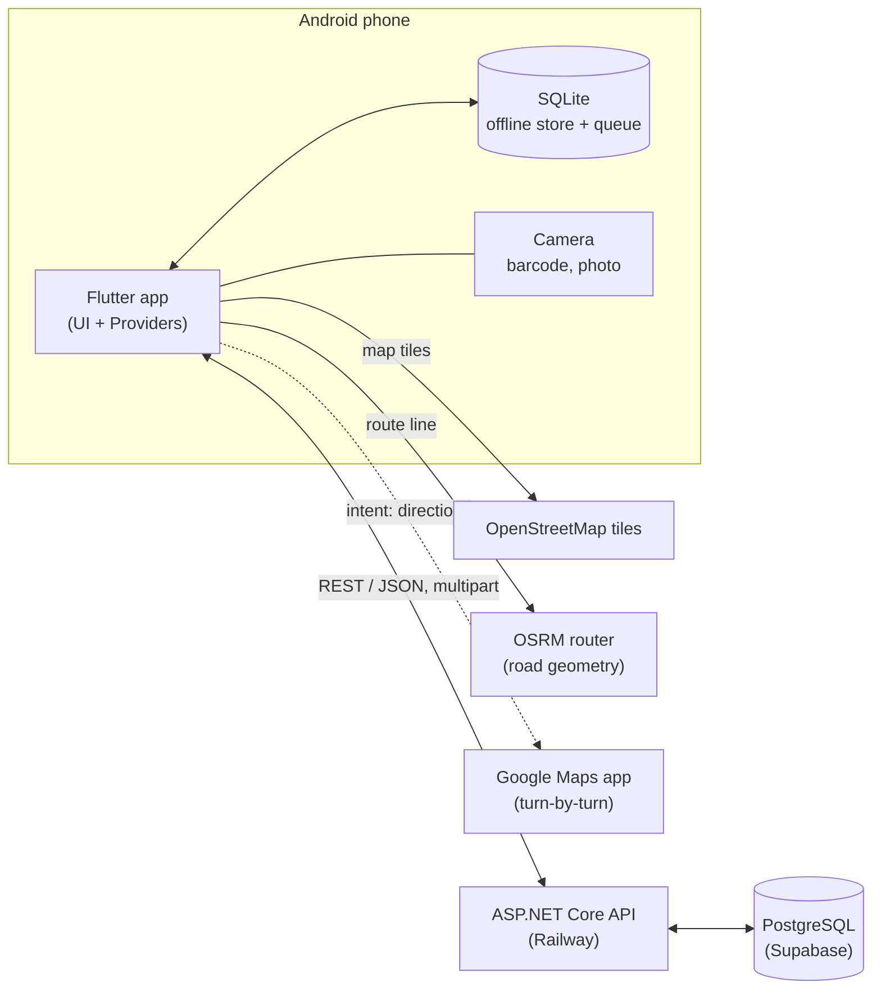

The phone talks to exactly one backend of its own. Map tiles, the road-following route line and turn-by-turn navigation come from public services and are **optional**: the app still works without them (the map just loses its background, and the line falls back to straight segments).

### 2.2 Backend

```
backend/
  Controllers/   Trips, Collections, Suppliers, Insights   (thin: validation + mapping)
  Services/      TripService (trip creation, collections, skipping)
                 RouteService (Haversine + Dijkstra)
                 SeedService (demo data, opt-in)
  Models/        Depot, Supplier, Trip, TripStop, Collection,
                 CollectionPhoto, CollectionSignature
  DTOs/          request / response shapes
  Data/          AppDbContext (EF Core)
  Migrations/    6 migrations
```

**API**

| Method | Path | Purpose |
|---|---|---|
| GET | `/api/trips/today` | Today's trip (created on first request) with the optimised stop sequence and live status per stop |
| GET | `/api/trips/{id}/summary`, `/api/trips/today/summary` | Report data: totals, per-stop collected vs expected, shortfall flags |
| GET | `/api/trips/history` | Past trips with totals and shortfall counts |
| POST | `/api/trips/{tripId}/stops/{supplierId}/skip` | Skip a stop and re-optimise the rest; returns the new trip |
| POST | `/api/collections` | Record one collection (idempotent) |
| POST | `/api/collections/sync` | Final confirmation push of many collections (idempotent) |
| POST / GET | `/api/collections/photo[...]` | Upload / download the proof photo |
| POST / GET | `/api/collections/signature[...]` | Upload / download the supplier signature |
| GET | `/api/insights?days=7` | Aggregated stats and daily totals (1 to 90 days) |
| GET / PUT | `/api/suppliers/{id}`, `/api/suppliers/{id}/contact` | Supplier profile with recent collections / update contact details |

**Data model**

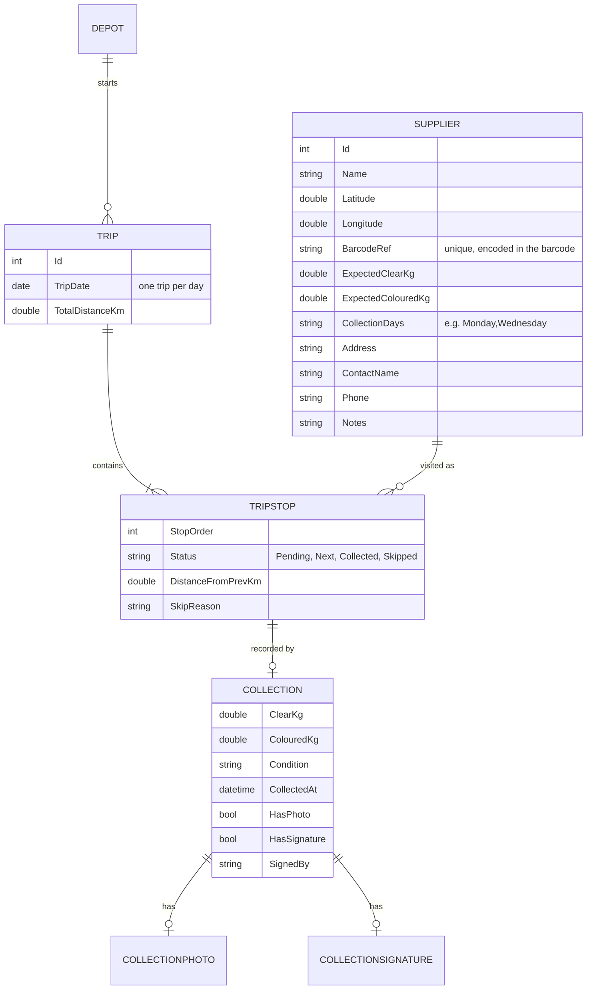

**Key backend decisions**

| Decision | Reason |
|---|---|
| **One trip per day**, generated on first request from the suppliers scheduled for that weekday (Colombo time) | Matches the brief ("today's supplier list"); the route is stable all day |
| **Unique index on `Supplier.BarcodeRef`** | The barcode is the only way to identify a supplier at a stop, so the database guarantees two suppliers can never share one. A duplicate is rejected with a clear error |
| **Status lives on the trip stop**, not the supplier | A supplier has a status *per trip*, as the brief requires |
| **Collections accept any unvisited stop**, not only the server's "Next" | A collector working offline may visit stops in a different order than the server last computed (for example after a skip). Rejecting those would lose data |
| **Collections, sync and photo/signature uploads are idempotent** | The phone retries until it gets an answer, so duplicates must be harmless |
| **Photos and signatures stored in PostgreSQL** (own tables, so ordinary queries never load image bytes) | Free hosting tiers have an ephemeral filesystem; files on disk would vanish on redeploy. Photos are compressed on the phone (about 200 KB) |
| **Opt-in seeding and migrations by configuration flag** (`Seed__*`, `Database__AutoMigrate`) | Nothing runs by default; safe for production |

**Route optimisation.** The server builds a complete graph where each supplier is a node and the edge weight is the Haversine distance, then runs Dijkstra from the depot and orders the stops. With straight-line distances the triangle inequality holds, so the shortest path to each stop is always the direct edge and the resulting order is effectively **nearest-neighbour**. It is a sensible route and it satisfies the brief, but it is not a full travelling-salesman solution (see [limitations](#8-known-limitations-and-next-steps)).

**Skipping a stop.** If the skipped stop was the current one, the same routing runs again over the remaining stops, starting at the skipped supplier's location. Finished stops keep their order, the remaining stops are renumbered, per-leg distances and the trip total are recomputed, and exactly one stop is promoted to Next.

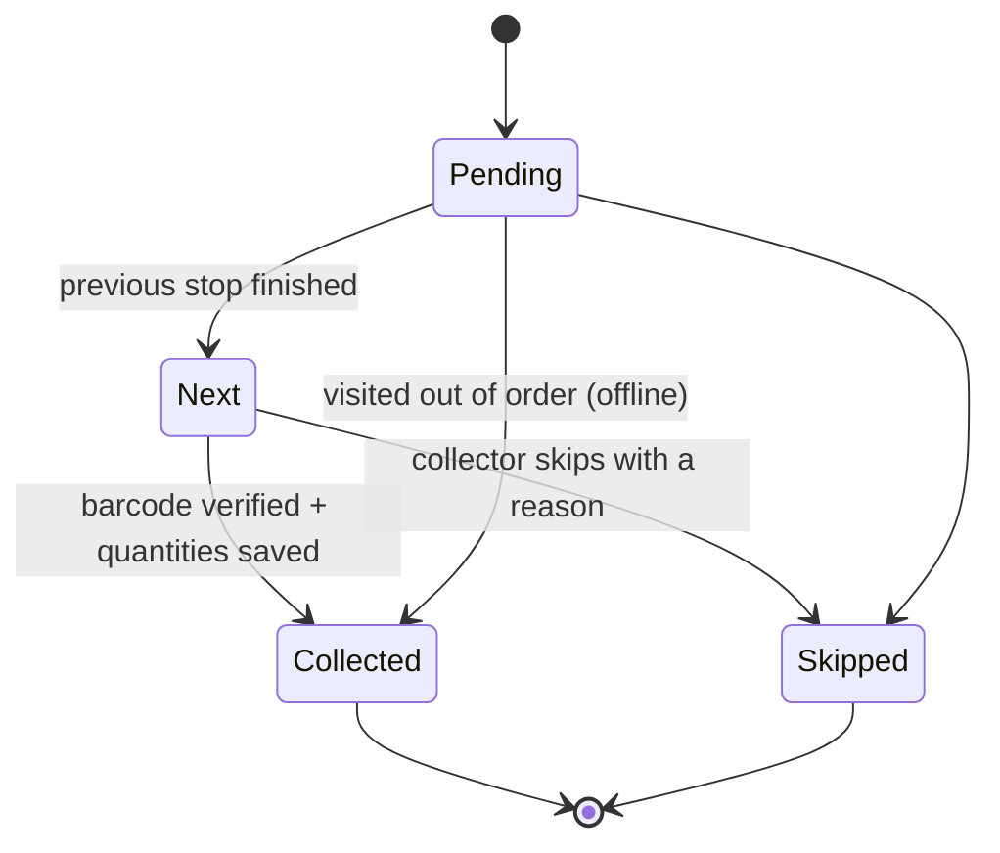

### 2.3 Mobile app

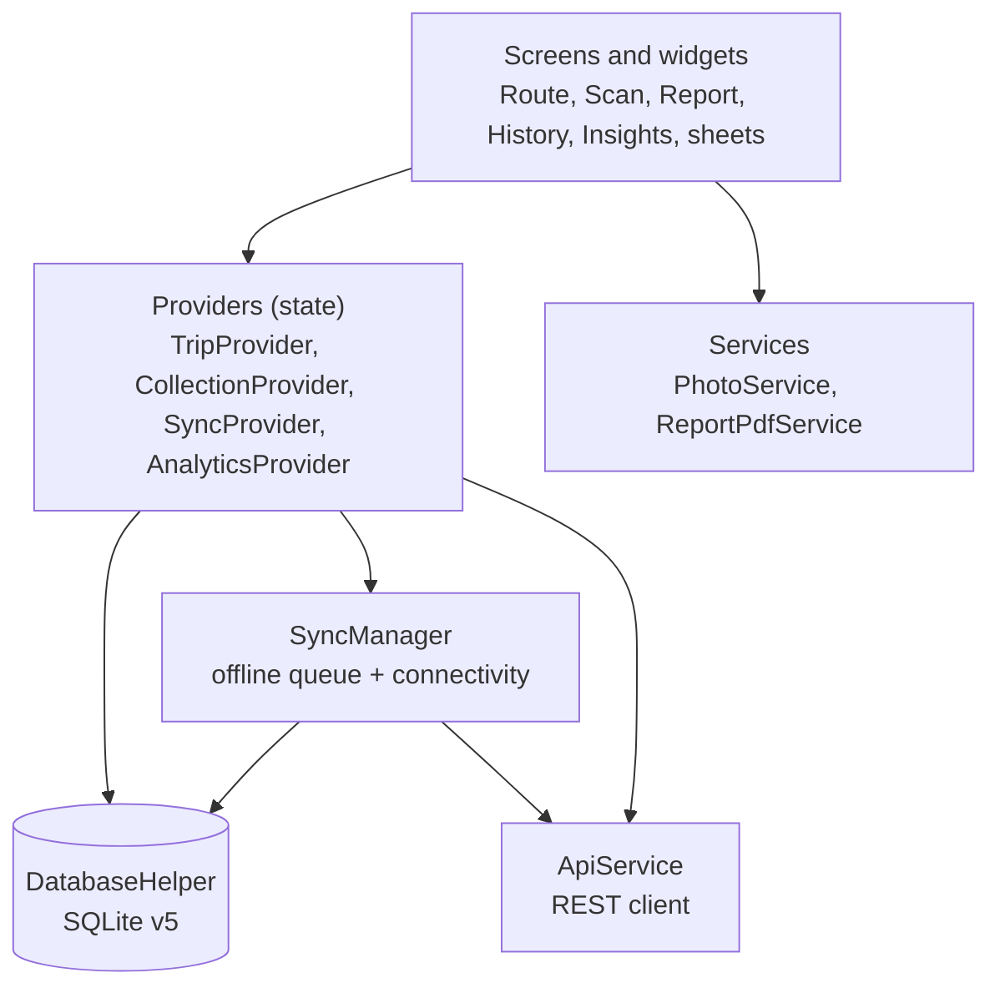

```
mobile/lib/
  theme/        design tokens + light/dark themes
  widgets/      shared components (status chip, hero header, state views, kg field, signature pad, ...)
  screens/      home_shell (bottom navigation), trip_sequence, scan_collect, trip_report, history, insights
  providers/    TripProvider, CollectionProvider, SyncProvider, SyncManager, AnalyticsProvider
  models/       Trip, TripStop, CollectionRecord, SkipRecord, TripReport, analytics, supplier detail
  db/           DatabaseHelper (SQLite)
  services/     ApiService, PhotoService, ReportPdfService
  utils/        formatting, navigation (Google Maps intent), page transitions
```

**Local database (SQLite, schema version 5).** Four tables: `trip_stops` (cached route with contact details), `trip_cache` (trip header), `collections` (each record plus sync flags for the collection, its photo and its signature), and `skips` (queued skips). Upgrades from older versions keep existing data, which matters because a collector may have unsent records when the app updates.

#### Offline-first sync queue

Everything the collector does is written to SQLite first. `SyncManager` then replays it to the server **in the order it happened**, because a skip changes the route and the order matters to the server.

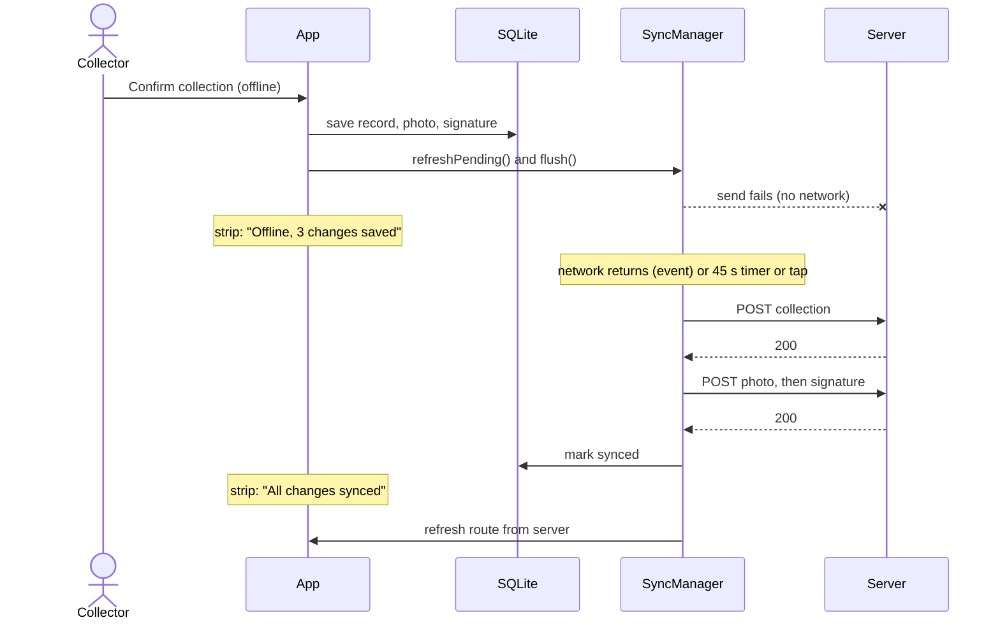

- **Triggers:** connectivity change (after a 1 second settle), a 45 second safety timer, a tap on the status strip, app start, and before every route refresh.
- **Failures:** a network or server error keeps the item queued. A permanent rejection (4xx) is dropped so one bad record cannot block everything behind it.
- **Consistency:** if some changes could not be uploaded when the route is refreshed, the app re-applies them on top of the server's copy, so a stop the collector already handled never comes back as Pending.

---

## 3. Design

### 3.1 Principles

- **One glance, one action.** The current stop is the largest thing on the Route screen and carries the only filled buttons (Navigate, Scan).
- **Never block the collector.** Saving is local and instant; network work happens in the background and is shown, never awaited.
- **State is always visible.** Status chips, the progress ring and the sync strip show where things stand without opening anything.
- **Errors say what to do.** For example "That barcode belongs to a different supplier. Head to Kurunegala Glass Traders."

### 3.2 Design system

| Token | Values |
|---|---|
| Brand | Indigo `#4F46E5`, deep indigo `#3730A3`, violet `#7C3AED`, ink `#0B1020`; hero gradient indigo to violet |
| Semantic | Success `#047857`, warning `#B45309`, error `#E11D48`; each with a container tint for light and dark |
| Typography | Plus Jakarta Sans, bundled with the app (works offline); display, title and label weights tuned for tight, bold headings |
| Spacing | 4 pt scale: 4, 8, 12, 16, 24, 32 |
| Corners | 10, 16, 24 and pill |
| Theme | Material 3, light and dark, follows the system setting |

Shared components: status chip, hero header, stat tile, progress ring, kg stepper field, empty / error / skeleton states, signature pad, proof photo viewer, sync status strip.

### 3.3 Interaction and motion

- Staggered list entrance, a pulsing marker on the current stop, count-up totals, animated rings and bars.
- Skeleton loaders (shimmer) instead of spinners for first loads; pull-to-refresh on lists.
- Haptics: success on a correct scan, a stronger buzz on a wrong one, a tick on choosing a condition.
- Page transitions: fade plus a slight upward slide; Android predictive back is supported.

### 3.4 Accessibility

- Screen-reader labels on stops ("Stop 2, Mawathagama Beverages"), the progress ring ("3 of 7 stops done"), map pins, status chips and the signature pad.
- Text size follows the system setting up to 1.3x so dense headers do not break; layout tests run at 320 dp width with 1.3x text.
- Tap targets of 48 dp or more; status never relies on colour alone (each status has an icon and a word).
- Light and dark themes, each with its own status colours, so status text stays legible on tinted backgrounds.

### 3.5 Branding

The icon is a route from a start dot to a destination pin on the brand gradient. It ships as an adaptive Android icon with a matching light/dark splash screen.

---

## 4. Feature walkthrough

Screenshots are from an Android emulator (Pixel, API 36, 1080 x 2400) running against the local backend with the demo data described in [section 7](#7-running-it-locally). Where noted, a screen was rendered by a widget test instead (see [section 6](#6-testing)).

### Route

| Route | Route overview map | Supplier sheet |
|:--:|:--:|:--:|
| 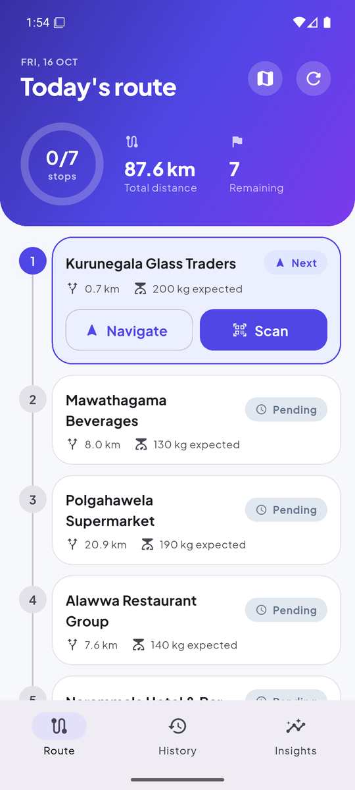 | 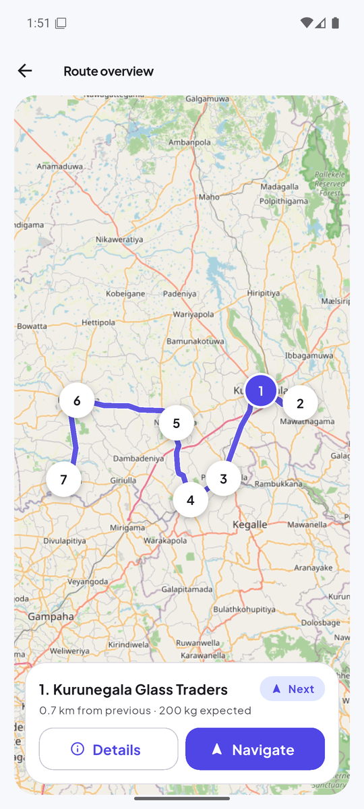 | 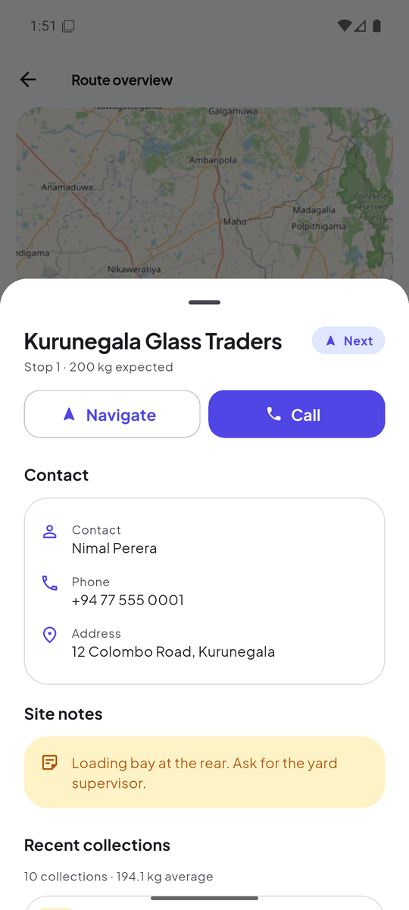 |

- The header shows progress (0/7 stops), total distance and what remains. Stops form a timeline; the current stop is highlighted with **Navigate** (opens Google Maps directions) and **Scan**.
- The map overview draws the road-following route with numbered pins coloured by status.
- Tapping a stop opens the supplier sheet: contact details (cached for offline use), tap-to-call, site notes, and recent collections with the average.

### Scan and collect

| Locked (emulator) | Wrong barcode * | Verified and unlocked * |
|:--:|:--:|:--:|
| 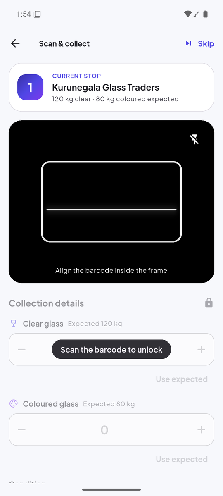 | 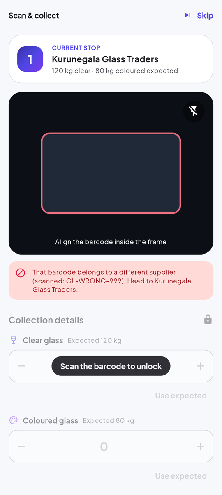 | 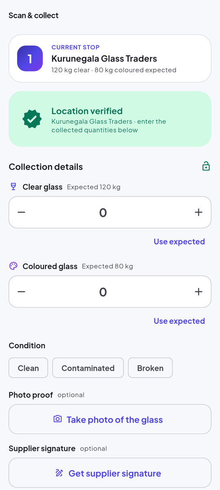 |

\* rendered by a widget test with a faked scanner (see section 6).

- The form stays locked until the scanned barcode equals the current stop's code. Any other code, including a real supplier's, is blocked with an explanatory message.
- Weights use steppers with a "Use expected" shortcut; condition is a choice (Clean, Contaminated, Broken).

| Shortfall hint * | Signature pad * | Skip a stop (emulator) |
|:--:|:--:|:--:|
| 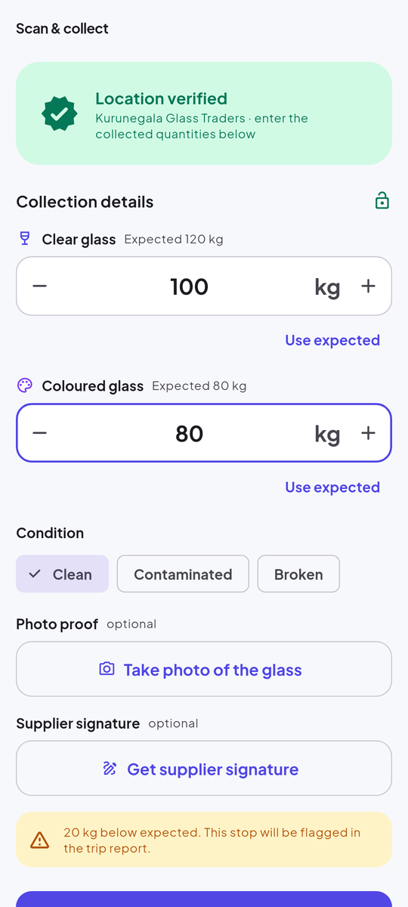 | 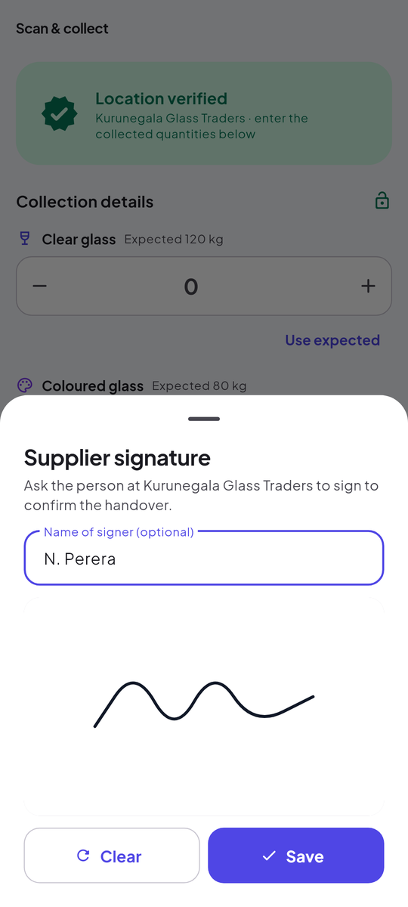 | 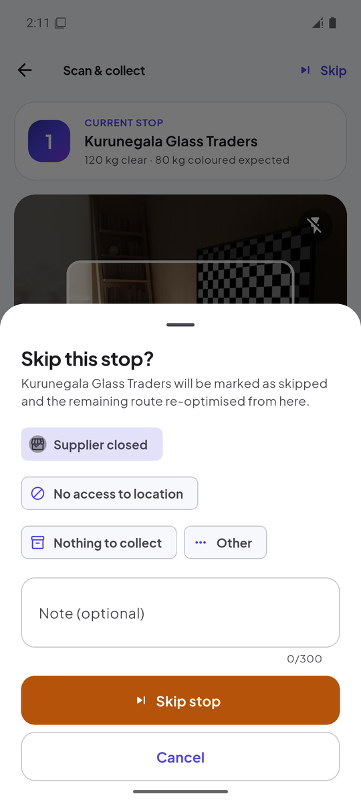 |

- Entering less than expected shows a live warning before confirming.
- Photo proof and the supplier's signature are optional and are queued like everything else.
- A stop that cannot be collected (closed, no access, nothing to collect) can be skipped with a reason; the rest of the route is re-optimised.

### Offline and sync

| Skipped while offline | Back online: synced |
|:--:|:--:|
| 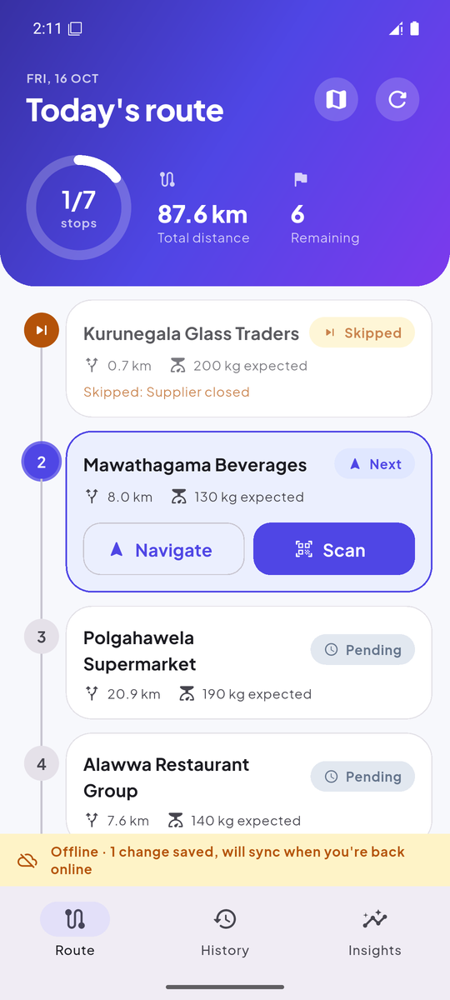 | 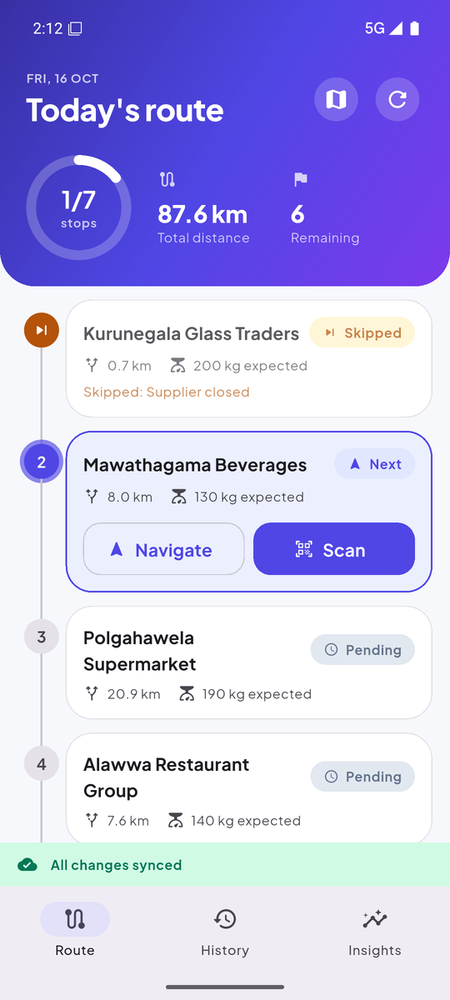 |

The left screenshot was taken with the emulator's Wi-Fi and mobile data switched off: the stop shows as Skipped immediately and the strip reports "1 change saved". On reconnect (right) the queue sends it, the strip flashes "All changes synced", and the server's route replaces the local one. The server state was checked afterwards: the stop was Skipped with the reason and the next stop was promoted.

### Trip report, history and insights

| Trip report | Stop breakdown | History |
|:--:|:--:|:--:|
| 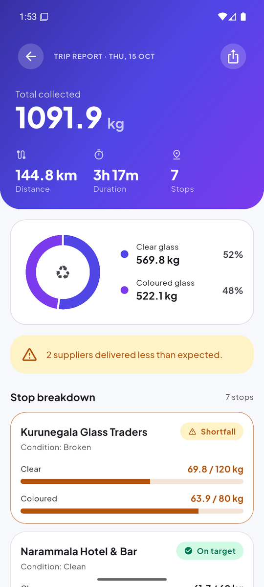 | 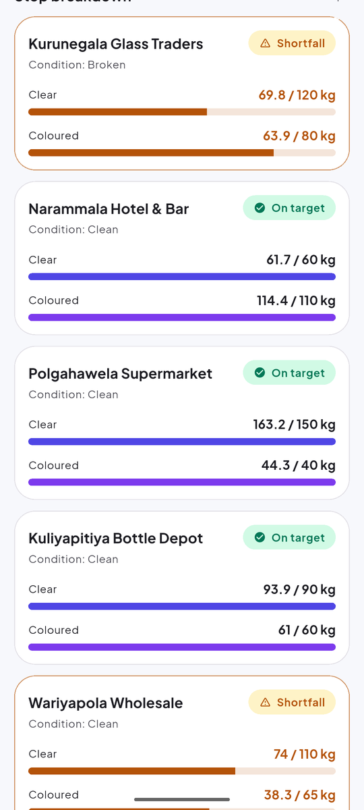 | 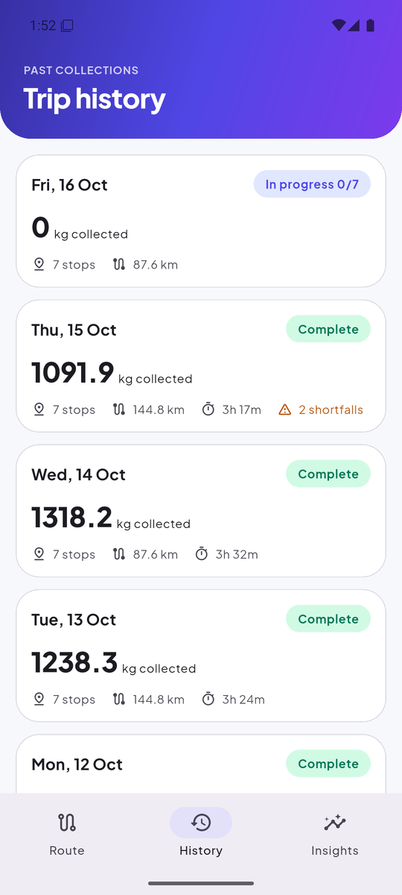 |

| Insights | Insights (dark) | Route (dark) |
|:--:|:--:|:--:|
| 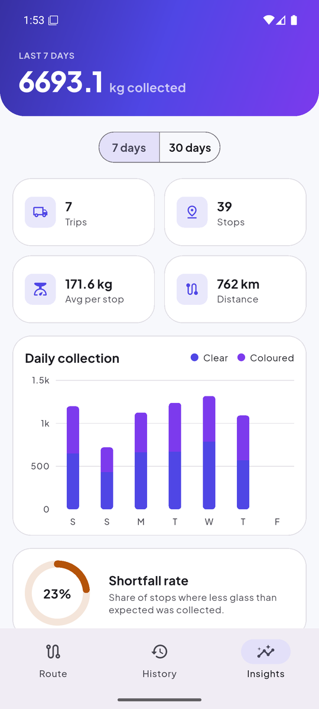 | 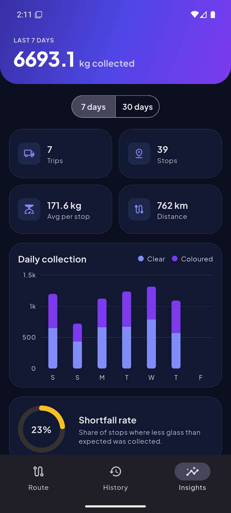 | 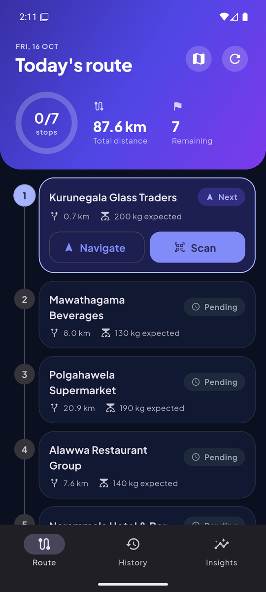 |

- The report shows total kg (clear against coloured), distance, duration, and a **Shortfall** flag on any stop below expected. Stops that were skipped or not visited yet are shown as such, never as shortfalls.
- It can be shared as a PDF (built on the phone, so it works offline).
- History lists past trips; opening one loads its full report, including photos and signatures, from the server.
- Insights summarises the last 7 or 30 days: totals, a stacked daily chart, shortfall rate and top suppliers.

---

## 5. Requirements traceability

How the original brief maps to the implementation.

| Requirement | Implementation | Status |
|---|---|---|
| Each supplier has a unique supplier ID encoded in its barcode | `Supplier.BarcodeRef` with a database unique index; demo codes `GL-SUP-001` to `010` | Done |
| Backend built from scratch, own schema and seed data | .NET API, PostgreSQL schema with 6 migrations, opt-in seeding | Done |
| Return today's suppliers with status and GPS | `GET /api/trips/today` | Done |
| Haversine + Dijkstra route on the backend | `RouteService` (see the note on nearest-neighbour in section 2.2) | Done |
| Status per trip: Pending, Next, Collected | `TripStop.Status` (plus Skipped as an extension) | Done |
| Screen 1: sequence, total distance, remaining stops | Route screen | Done |
| Screen 2: scan, verify against the expected stop, unlock form | Scan gate; wrong code blocked. No manual override | Done |
| Form: clear kg, coloured kg, condition; post and advance | Scan screen, `POST /api/collections` | Done |
| Screen 3: per-supplier summary, total kg, distance, duration, shortfall warning | Trip report | Done |
| "Sync to server" with clear success or failure | Report sync bar; data stays local on failure | Done |
| Offline-first with SQLite | Local store plus the sync queue | Done |
| Hosted backend and database | Railway + Supabase (configuration in place) | Deploy the latest build and apply migrations |
| APK pointing at the hosted URL | Default `baseUrl` is the Railway URL; override with `--dart-define` | Build the release APK |
| Screen recording of the full flow | Script in `docs/testing/TEST_PLAN.md`, section K | To record |
| README with setup | Section 7 here | Done |

The brief scoped the app to three screens. The extra tabs and features are a deliberate extension for the portfolio; the three-screen core flow works on its own.

---

## 6. Testing

### 6.1 Strategy

| Level | What | Where |
|---|---|---|
| Static checks | `flutter analyze` (no issues), `dotnet build` (0 errors) | CI-ready commands |
| Backend API | **54 automated checks** over the running API | `docs/testing/api-smoke-test.sh` |
| Database constraints | Unique supplier barcode, checked directly in PostgreSQL | Section 6.4 |
| Mobile automated | **21 tests** (unit and widget) | `mobile/test/` |
| Manual, on device | About 150 cases with expected results | `docs/testing/TEST_PLAN.md` |
| End-to-end on an emulator | The app against a real local backend and database | Section 6.4 |

### 6.2 Automated results

| Suite | Result |
|---|---|
| Backend API smoke test | **54 passed, 0 failed** |
| Flutter tests | **21 passed, 0 failed** |
| `flutter analyze` | No issues |
| `dotnet build` | 0 errors, 1 dependency advisory (see section 8) |

**Flutter tests**

| File | Tests | Covers |
|---|---:|---|
| `scan_gate_test.dart` | 4 | A fake scanner pushes barcodes into the real Scan screen: a code for no supplier and a code for another supplier both keep the form locked; the correct code unlocks it; validation, condition, shortfall hint and error clearing; the submission carries the right trip, supplier and values; the signature pad |
| `layout_test.dart` | 8 | Timeline tile in each status, the weight field and header stats, in light and dark, at 320 dp width and 1.3x text (fails on any overflow) |
| `trip_report_model_test.dart` | 3 | Unvisited, current and skipped stops are never counted as shortfalls; an in-progress trip has none |
| `report_pdf_test.dart` | 3 | PDF generation (normal, shortfall, skipped, pending, 80-stop multi-page); file naming |
| `signature_pad_test.dart` | 1 | Drawing fills the pad and exports a valid PNG |
| `widget_test.dart` | 2 | Status chips render in both themes |

**Backend smoke test** (`api-smoke-test.sh`, 54 checks) covers:

- trip generation, a single trip per day, exactly one Next, ordered stops;
- recording a collection, idempotent repeats, unknown supplier (404), and collecting a non-current stop (the offline case);
- skipping: idempotent, refused for a collected stop (400), empty reason (400), unknown stop (404), collection after a skip refused;
- photo and signature: wrong type (400), oversized (400), missing collection (404), replacement, download, links in the summary;
- reports: skipped and pending stops are not shortfalls; history flags; insights clamped to 90 days; supplier detail and contact update;
- the final sync completing the trip, and being safe to repeat.

### 6.3 Manual test plan

`docs/testing/TEST_PLAN.md` has about 150 cases with exact expected values. It includes the **expected route, distance and kg for every weekday** (computed by reproducing the routing algorithm), printable Code 128 barcodes for all demo suppliers plus an unknown code for the negative test, offline and sync scenarios, accessibility checks, and a 10-step script for the demo recording. All barcodes were verified to decode back to their supplier ID.

### 6.4 End-to-end run on an emulator

The app was installed on an Android emulator (Pixel, API 36) and pointed at a local backend with a fresh PostgreSQL 18 database, so the hosted database was untouched.

| Check | Observed |
|---|---|
| Route for a Friday | 7 stops, **87.6 km**, same order and same per-leg distances as the test plan's computed values |
| History and Insights | 11 trips (10 completed plus today); 7-day insights: 7 trips, 39 stops, 6,693 kg, 23% shortfall rate |
| Map | OpenStreetMap tiles load; the route line follows roads once the router answers |
| Supplier sheet | Contact, notes and recent collections load from the server |
| Trip report from the server | Totals, donut chart, shortfall flags and per-stop bars correct |
| Unique barcode | The index exists (`IX_Suppliers_BarcodeRef`); inserting a second supplier with `GL-SUP-001` fails with `duplicate key value violates unique constraint`; re-running the seed is unaffected; the 54 API checks still pass |
| Dark mode | Route and Insights render correctly |
| Offline skip | With Wi-Fi and data off: stop marked Skipped, strip "1 change saved" |
| Reconnect | Strip shows "1 change not synced", retries by itself, then "All changes synced"; server confirms Skipped plus the next stop promoted |

**Not verifiable on the emulator, and how each is covered:**

| Item | Why | Coverage |
|---|---|---|
| Scanning a real barcode through the camera | The emulator camera cannot be pointed at a barcode without its graphical controls | Widget test with a faked scanner; barcodes verified to decode; **still to do on a real phone** |
| Taking a photo, drawing a signature on the device, sharing the PDF through the system sheet | Needs the device camera app and share targets | PDF and signature export covered by unit tests; photo and share **to verify on a real phone** |
| Release APK against the hosted backend | Cleartext HTTP is blocked in release builds, so it must use the https URL | **To verify** after deploying |
| TalkBack walkthrough | Not run | **To verify** |

### 6.5 Defects found during testing

Testing found real problems. They were fixed and, where practical, locked in with tests.

| # | Problem | How it was found | Fix |
|---|---|---|---|
| 1 | The new theme, app title and text-size cap were never applied | Screenshots on a real device still showed the old green theme | Corrected `main.dart`; every earlier edit was then audited for the same silent failure |
| 2 | Trips in progress showed "2 shortfalls" and amber 0/45 kg bars | Device screenshot of History and the report | Backend and app now treat only collected stops as able to fall short; pending and skipped stops have their own display; tests added |
| 3 | History detail ignored skipped, photo and signature data | A unit test on the report model | Parsing fixed |
| 4 | Offline collections could be rejected by the server after a skip changed the order; the sync endpoint did not mark stops Collected; two stops could be "Next" | Design review of the offline flow | One idempotent method that accepts any unvisited stop; exactly one Next is guaranteed |
| 5 | Unsynced work could reappear as Pending after a refresh | Design review | Refresh pushes pending changes first, then re-applies any that failed |
| 6 | Map showed "API KEY REQUIRED" watermarks and straight lines | Device screenshot | Switched to OpenStreetMap tiles and OSRM road geometry |
| 7 | Insights: wrapped Y-axis labels, an empty gap above the stat cards, unreadable status-bar icons on the gradient header | Emulator screenshots | Compact axis labels, zero grid padding, light status-bar icons over gradients |
| 8 | Validation errors stayed after the value was corrected | Rendered test screenshot | Fields re-validate as the user types |
| 9 | Supplier barcodes were unique only by convention; the database did not enforce it, although the brief requires unique supplier IDs and a duplicate would let the wrong stop verify | Fact-checking this documentation against the schema | Unique index plus migration `AddUniqueSupplierBarcode`; duplicate insert verified to fail |

---

## 7. Running it locally

### Backend

```bash
cd backend
dotnet ef database update          # or set Database__AutoMigrate=true

# First run: depot + 10 demo suppliers, 10 days of history, a fresh trip for today
env Seed__Suppliers=true Seed__History=true Seed__ResetToday=true dotnet run
```

| Flag | Effect |
|---|---|
| `Seed__Suppliers` | Adds a depot and suppliers `GL-SUP-001` to `010`. Idempotent; never edits existing rows |
| `Seed__History` | Creates 10 days of completed past trips |
| `Seed__SupplierDetails` | Fills only empty contact fields with fake values |
| `Seed__ResetToday` | **Deletes today's trip** so a fresh one is generated. Testing only; remove it afterwards |
| `Database__AutoMigrate` | Applies pending migrations at startup |

If an existing database already contains two suppliers with the same barcode, the `AddUniqueSupplierBarcode` migration will fail; correct the duplicates first.

The connection string is `ConnectionStrings:DefaultConnection` (in the git-ignored `appsettings.json`, or as the environment variable `ConnectionStrings__DefaultConnection`).

### Mobile app

```bash
cd mobile
flutter pub get

# Android emulator talking to a backend on the host machine
flutter run --dart-define=API_BASE_URL=http://10.0.2.2:5081
# Real phone on the same network: use the PC's LAN IP instead of 10.0.2.2
```

Without `API_BASE_URL` the app uses the hosted Railway URL. Release builds block plain `http://`, so a release APK must point to an `https://` backend.

### Tests

```bash
cd mobile && flutter analyze && flutter test
cd backend && dotnet build
docs/testing/api-smoke-test.sh http://localhost:5081   # against a demo database
```

The smoke test changes today's trip. Run the backend once with `Seed__ResetToday=true` to reset it before running the test again.

### Test barcodes

`docs/testing/test-barcodes.pdf` (one page per three codes) and `docs/testing/barcodes/*.png`. Display them on a second screen or print them and scan them with the app.

---

## 8. Known limitations and next steps

| Area | Limitation | Possible next step |
|---|---|---|
| Routing | Straight-line distances make the Dijkstra step reduce to nearest-neighbour; the route is good but not optimal | Use road distances and a TSP heuristic (2-opt) or an optimisation service |
| Authentication | None, as the brief specifies | Add per-collector accounts and trips |
| History and Insights | Need a connection (not cached) | Cache the last responses in SQLite |
| Map | Tiles and road geometry come from public servers meant for light use | A hosted tile and routing provider for production |
| PDF | Built-in Latin font only; photos are not embedded | Bundle a Unicode font; embed thumbnails |
| Rejected records | A permanently rejected (4xx) record is dropped from the queue without telling the user | Show it in a "needs attention" list |
| Dependencies | `dotnet build` reports advisory NU1903 for `Microsoft.OpenApi` 2.0.0 (a transitive dependency, used only in Development) | Pin a patched version |
| Automated coverage | No automated tests for `SyncManager` or the backend services | Add a SQLite test setup and an xUnit project with an in-memory or containerised database; CI to run all suites |
| Device verification | Camera scan, photo capture and the share sheet are untested on a physical device | Run sections B to F of the test plan on a phone |
